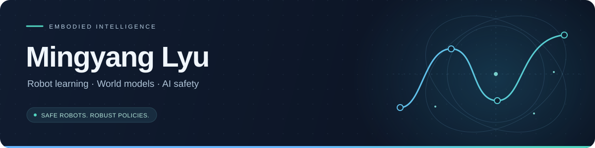
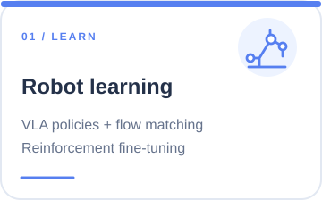
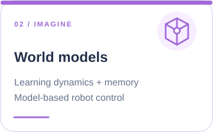
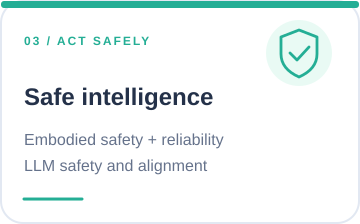
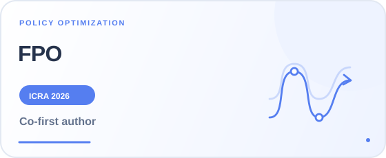
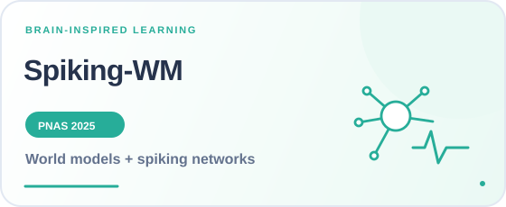

  

  <b>PhD student · CASIA &amp; Zhongguancun Academy</b>

  
  
  
  

## About

I study how embodied agents can **learn, imagine, and act reliably**. My work connects reinforcement learning, vision-language-action models, world models, and AI safety.

- **Institute of Automation, Chinese Academy of Sciences (CASIA)** — National Key Laboratory of Cognition and Decision Intelligence for Complex Systems; working with [Pin Lyu](https://people.ucas.ac.cn/~lvpin).
- **Zhongguancun Academy** — advised by [Chen Gao](https://fi.ee.tsinghua.edu.cn/~gaochen/).

Background: B.Eng. in Automation, Xi’an Jiaotong University (2024) · Graduate research at CASIA / UCAS since 2024.

## Research focus

  
  
  

## Selected work

<table>
  <tr>
    <td width="50%" valign="top">
      
      <b>Reinforcement Fine-Tuning of Flow-Matching Policies for Vision-Language-Action Models</b> 
      Online reinforcement learning for flow-matching VLA policies.
      
<a href="https://arxiv.org/abs/2510.09976">Paper</a> · <a href="https://github.com/tuotuoLyu/FPO">Code</a>

    </td>
    <td width="50%" valign="top">
      
      <b>A Unified Diagnostic Safety Benchmark for Vision-Language-Action Models</b> 
      Diagnosing physical, instruction, and perception risks in robot policies.
      
<a href="https://arxiv.org/abs/2606.27079">Paper</a> · <a href="https://github.com/tuotuoLyu/ForesightSafety-VLA">Code</a>

    </td>
  </tr>
  <tr>
    <td width="50%" valign="top">
      
      <b>Competitive Multi-Agent Game-Theoretic Tracking with Vision-Language-Action Models</b> 
      Competitive multi-agent reinforcement learning for embodied visual tracking.
      
<a href="https://eccv.ecva.net/virtual/2026/poster/3708">Paper · ECCV</a> · <a href="https://link.springer.com/chapter/10.1007/978-3-032-37574-2_14">Proceedings</a>

    </td>
    <td width="50%" valign="top">
      
      <b>Spiking world model with multicompartment neurons for model-based reinforcement learning</b> 
      Connecting dendritic computation, spiking networks, and world models.
      
<a href="https://doi.org/10.1073/pnas.2513319122">Paper</a> · <a href="https://github.com/Brain-Cog-Lab/Spiking-WM">Code</a>

    </td>
  </tr>
</table>

<b>More papers</b>

- [TEFormer: Structured Bidirectional Temporal Enhancement Modeling in Spiking Transformers](https://arxiv.org/abs/2601.18274)
- [Light Alignment Improves LLM Safety via Model Self-Reflection with a Single Neuron](https://arxiv.org/abs/2602.02027)
- [SafeMind: Benchmarking and Mitigating Safety Risks in Embodied LLM Agents](https://arxiv.org/abs/2509.25885)

[Full publication list →](https://scholar.google.com/citations?user=sCrVbNsAAAAJ)

## Research & industry experience

### WILL · WizardQuant (宽德投资)
🟣 Aug 2026 – Present · Physical simulation & foundation-model post-training

- Develop and debug physics simulation environments.
- Work on reinforcement-learning post-training for foundation models.

### 细胞壁科技
🔵 Mar 2026 – Jul 2026 · Research Intern

- Study cross-episode memory and in-context learning for frozen VLA backbones.
- Explore memory-augmented human–robot interaction to improve adaptation and sample efficiency.

### Amap (高德地图)
🟠 Dec 2025 – Feb 2026 · Research Intern · CoMaTrack

- Research competitive multi-agent tracking and game-theoretic interactions for VLA policies.
- Third author of [CoMaTrack](https://eccv.ecva.net/virtual/2026/poster/3708), published in the ECCV 2026 proceedings.

### Ant Group (蚂蚁集团)
🟢 Oct 2025 – Dec 2025 · AI Safety Research

- Research lightweight, transferable inference-time safety alignment for LLMs.
- Contributed to [single-neuron self-reflection for LLM safety](https://arxiv.org/abs/2602.02027), balancing generation safety and model utility.

## Service & engineering

- **Reviewer — CoRL 2026.**
- **Electrical Control Lead — XJTU Intelligent Robotics Team** (Sep 2022 – Sep 2023). Led embedded control, motor-drive, power, and communication-system development; worked on sensor fusion and visual tracking across 10+ robot prototypes.
- **National Undergraduate Innovation Project** (Sep 2021 – Dec 2022). Developed an Intel-based driving-safety assistance system, integrating lane-departure and fatigue detection with embedded control and real-time data processing.

<b>Selected honors</b>

- **Third Place**, Zhongguancun Academy Hackathon & Innovation Competition, 2025.
- **Third Prize (Shaanxi)**, National Undergraduate Electronics Design Contest, 2023.
- **Third Prize**, Xi’an Jiaotong University “Tengfei Cup” Innovation & Entrepreneurship Competition, 2023.

## Notes & tools

**[Physical Intelligence research notes](https://github.com/tuotuoLyu/physical-intelligence-survey)** — a Chinese-language review of the π-series robot foundation models, from architectures and training signals to deployment.

Python · JAX · PyTorch · C++ · ROS · MuJoCo · RoboTwin · LIBERO · Isaac Sim · LaTeX

<a href="mailto:lvmingyang2024@ia.ac.cn">lvmingyang2024@ia.ac.cn</a>

